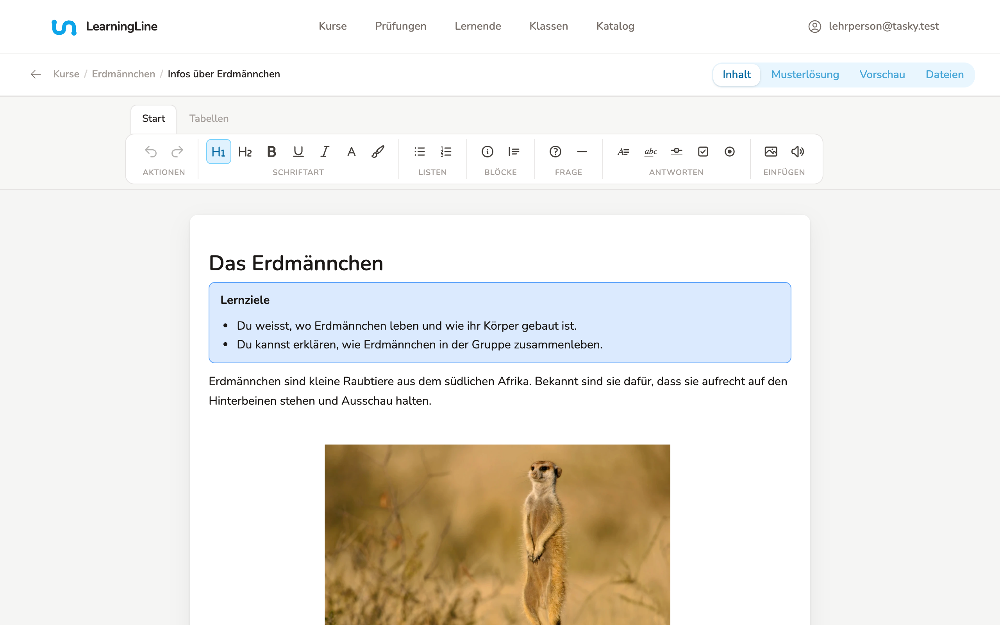
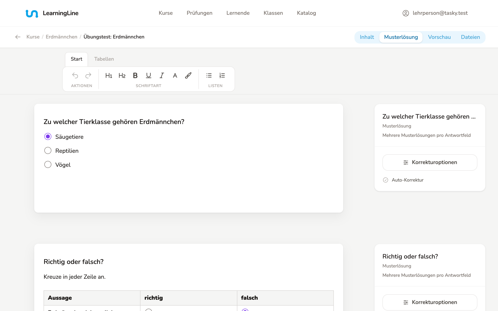
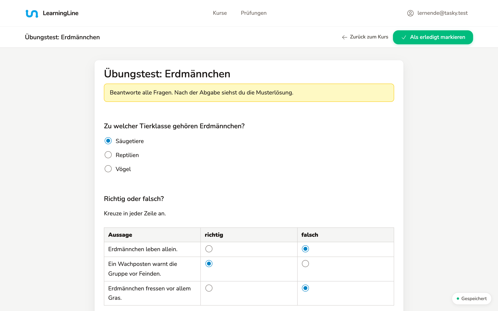

# LearningLine

[](https://github.com/schmt5/tasky/actions/workflows/ci.yml)


**A learning and exam platform for schools.** Teachers write learning units and
exams in a rich-text editor with interactive answer fields, learners work on
them in the browser, and teachers correct, grade and export the results — with
deterministic auto-correction doing the first pass.

LearningLine is currently being piloted at **be-med**.



<table>
  <tr>
    <td></td>
    <td></td>
  </tr>
  <tr>
    <td align="center">Sample solution: pins and their target zones</td>
    <td align="center">The learner's view of a practice exam</td>
  </tr>
</table>

## Contents

- [Features](#features)
- [Tech stack](#tech-stack)
- [Engineering highlights](#engineering-highlights)
- [Quality](#quality)
- [Getting started](#getting-started)
- [Project layout](#project-layout)
- [Deployment](#deployment)
- [About](#about)

## Features

### Authoring

- **One editor for units and exams** (Tiptap): question headings, callouts,
  quotes, tables, images and audio, plus answer fields — gap text, short
  answer, essay, single choice (also one radio group per table row), multiple
  choice, and **pin images** where learners place numbered pins on a picture.
- **Sample solutions per question**, with alternatives (`Kamel;Dromedar`) and
  per-question correction options (case sensitivity, per-checkbox scoring,
  target zones for pins).
- **Audio with play limits** — e.g. a listening text that can be played at
  most twice.
- **Print-ready PDFs**: a paper version of an exam whose answer boxes the
  teacher sizes line by line, and worksheet/solution PDFs for units.

### Exams

- Lifecycle `draft → open → running → finished → archived`, enforced in the
  domain layer.
- **Guest access via enrollment links** — learners need no account.
- **Live cockpit**: a waiting room (Phoenix Presence) and a progress grid that
  shows, per question and learner, what has been answered and whether it is
  right so far.
- **Safe Exam Browser** integration: the server hands out the SEB config and
  checks the config-key hash SEB sends with its requests — reporting only at
  first, blocking once the setup is confirmed in a trial run.
- **Correction** per submission or **per question across all submissions**,
  with auto-correction as a starting point that never overwrites a teacher's
  manual verdict.
- **Grading** on the Swiss 1–6 scale with configurable rounding, returning the
  corrected exam to learners, and a **ZIP export** of one PDF per submission.

### Courses & learning units

- Courses with units that are released step by step
  (`draft → locked → open`), optional "extended" units, and a progress view
  per learner.
- **Self-check** for learners and a sample-solution release mode per unit
  (never, manually, or on completion).
- File upload fields, an anonymous feedback box per course, and duplication of
  whole courses.
- A **cross-school catalog** to publish and import courses, and an **AI link**
  that serves a whole course as Markdown, e.g. for an AI assistant to draft
  exam questions from.

### Schools

- **Multi-tenant**: organizations (schools) share their classes and learners
  among their teachers; courses and exams stay private to their owner.
- **Invitation-only registration**: a class link makes a learner, an
  organization invite token makes a teacher. Roles: admin, teacher, learner.

## Tech stack

| Layer | Technology |
|---|---|
| Backend | Elixir 1.18 / OTP 28, Phoenix 1.8, Phoenix LiveView 1.1, Ecto, Bandit |
| Database | PostgreSQL 18 (Neon in production) |
| Frontend | LiveView + React 19 / Tiptap 3 editor islands (TypeScript, Radix UI), Tailwind CSS v4, esbuild |
| PDF | [Typst](https://typst.app) via an in-process NIF — no headless browser, no PDF service |
| Storage | Local disk in dev, private Cloudflare R2 bucket with presigned URLs in production (`req_s3`) |
| Hosting & CI | Fly.io (stateless machines), GitHub Actions |

## Engineering highlights

The design decisions behind these are written up in
[`ARCHITECTURE.md`](ARCHITECTURE.md).

- **One document, three renderers.** Every unit and exam is stored as Tiptap
  JSON. Teachers edit it in React, learners answer on an HTML answer sheet the
  server renders from the same JSON, and PDFs are rendered by a Typst template
  that walks the same JSON. Unknown nodes degrade to their children in both
  server renderers, so neither can crash on a node it does not know yet.
- **Content and sample solution are split by stable ids.** The teacher authors
  questions and model answers in one document; on save it is split into the
  answer-free content learners receive and a map of answers keyed by each
  field's `answerId`. Learners never get the solution, and reordering
  questions never loses one.
- **Tenant isolation by construction.** `role`, `organization_id` and
  `class_id` are not castable from forms, a check constraint keeps learners'
  organizations derived from their class, and the policy layer fails closed:
  no organization means no visibility.
- **A pure grading core.** Rounding grids, verdicts, part and total points and
  the mark formula live in pure modules (`Tasky.Grading`, `Tasky.ExamDoc`,
  `Tasky.ExamPaper`), shared by screen and PDF.
- **OTP where it pays off.** Bulk auto-correction runs as one supervised
  process per exam (Registry singleton, overlapping triggers queue a re-run),
  decoupled from the exam context through PubSub. Exports render two PDFs at a
  time and ship a ZIP with a failure manifest on partial success.
- **Built for live data.** Stateless machines, migrations on boot, a boot that
  fails fast on missing configuration, and column drops only in a later deploy
  so a rollback never meets a missing column.

## Quality

`mix precommit` runs exactly what CI runs, on every push and pull request:

- `compile --warnings-as-errors`, `format --check-formatted`, unused-dependency check
- `credo --strict`, `sobelow` (security), `dialyzer` (types)
- ~1,500 ExUnit tests with a coverage gate (`mix coveralls`), including
  LiveView tests driven through the rendered pages
- TypeScript type check and Node tests for the editor's JavaScript

## Getting started

**Requirements:** Elixir 1.18 / OTP 28, Node.js 22, PostgreSQL 18.

Dev and test expect Postgres on **port 5433** with trust auth for your OS user
(a Homebrew `postgresql@18` cluster kept off the default port, so it can run
next to other clusters). Override with `PGHOST` / `PGPORT` / `PGUSER` /
`PGPASSWORD` if your setup differs.

```sh
brew install postgresql@18
echo "port = 5433" >> "$(brew --prefix)/var/postgresql@18/postgresql.conf"
brew services start postgresql@18
```

```sh
mix setup                              # dependencies, database, assets
mix run priv/repo/dev_users.exs        # an admin, a teacher and a learner
mix run priv/repo/demo_course.exs      # a demo course using every editor block
mix phx.server                         # http://localhost:4001
```

The dev logins and their password are printed by `dev_users.exs`. The demo
course, *Erdmännchen* (meerkats; German, like the UI), belongs to the teacher
and has the learner enrolled: a unit with facts and a practice test.

```sh
mix precommit    # the full CI pipeline
mix test         # tests only
```

## Project layout

```
lib/tasky/              domain: contexts, policy, grading, correction, PDF
lib/tasky_web/          web: LiveViews, controllers, plugs, components
assets/js/react/        the Tiptap editor (React, TypeScript)
priv/typst/             the Typst template that renders documents as PDF
priv/repo/              migrations and seed scripts
test/                   ExUnit and LiveView tests
docs/                   feature guides and plans
```

Further reading:

- [`ARCHITECTURE.md`](ARCHITECTURE.md) — context map, document and grading model
- [`docs/ROBUSTNESS_PLAN.md`](docs/ROBUSTNESS_PLAN.md) — the phased hardening plan and project-wide decisions
- [`docs/BULK_CORRECTION.md`](docs/BULK_CORRECTION.md) — correcting per question across all submissions
- [`docs/DEPLOYMENT.md`](docs/DEPLOYMENT.md) — Fly.io, Neon and R2 setup
- [`AGENTS.md`](AGENTS.md) — conventions for AI coding agents working in this repo

## Deployment

Production runs on Fly.io with Neon Postgres and a private Cloudflare R2
bucket; `fly deploy` is all a release needs. Setup, secrets and the reasoning
behind the configuration are in [`docs/DEPLOYMENT.md`](docs/DEPLOYMENT.md).

## About

LearningLine is a solo project by [Thierry Schmidt](https://github.com/schmt5):
designed, built and operated by me since February 2026. The codebase is named
`tasky`, the project's original working title.
